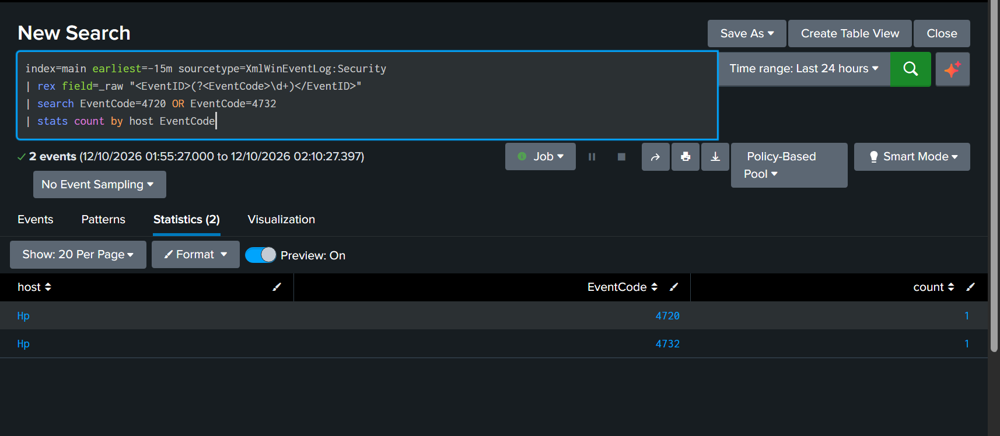
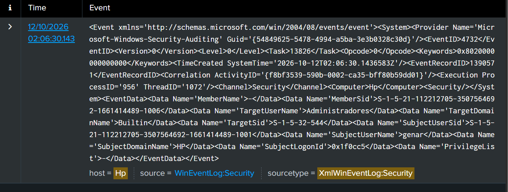
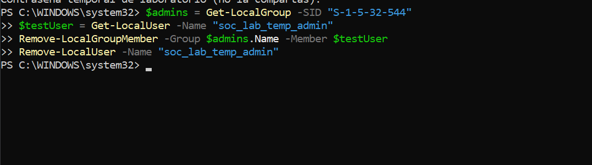
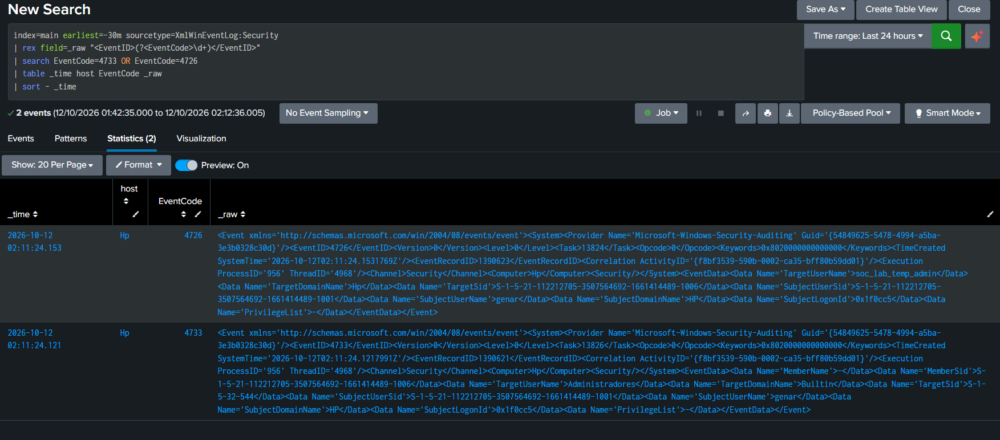
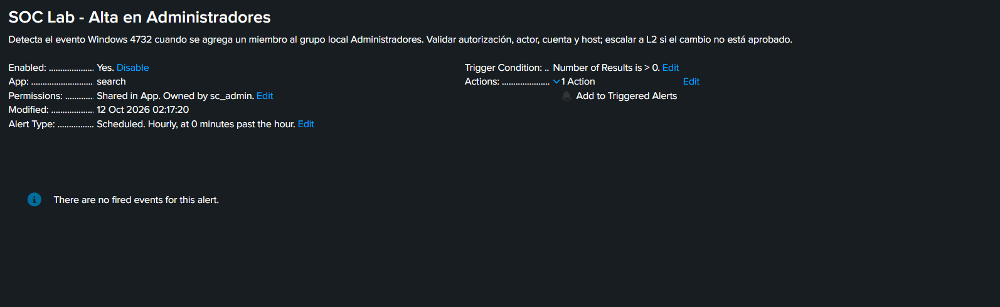
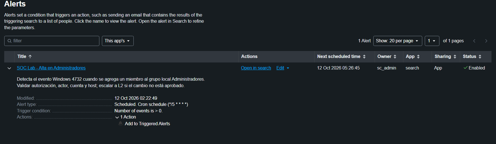
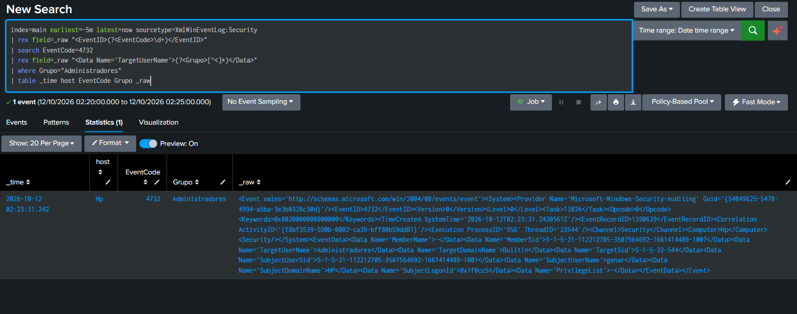
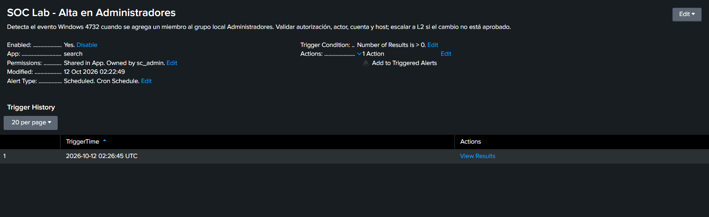

# Caso 004 — Detección de alta en Administradores locales con Splunk

**Categoría:** Gestión de cuentas / cambio de privilegios
**Severidad potencial:** Alta si el cambio no está autorizado
**Plataforma:** Windows Security Event Log, Splunk Universal Forwarder y Splunk Cloud
**Resultado del laboratorio:** detección correcta de una actividad autorizada; alerta ajustada, respuesta simulada y limpieza realizadas

## Resumen ejecutivo

En un laboratorio propio generé un cambio controlado en la membresía del grupo local **Administradores** usando cuentas temporales deshabilitadas. El Universal Forwarder envió los eventos de Windows Security a Splunk Cloud, donde reconstruí la secuencia con SPL y configuré una alerta programada para detectar el evento **4732** cuando el grupo objetivo es Administradores.

La alerta se creó inicialmente con frecuencia horaria; la cambié a una programación cron cada cinco minutos para reducir la demora de detección. Con la configuración final, el evento 4732 registrado a las **02:23:31 UTC** disparó la alerta a las **02:26:45 UTC**, unos 3 minutos y 14 segundos después. Validé actor, equipo, grupo y SID, y retiré las cuentas temporales.

**Clasificación:** verdadero positivo de la regla — ocurrió el cambio que la detección debía encontrar. **Veredicto de seguridad:** actividad benigna y autorizada del laboratorio; no es un incidente real ni un falso positivo.

## Alcance y entorno

- Equipo Windows de laboratorio (host `Hp`), con eventos de Security recolectados por Splunk Universal Forwarder.
- Splunk Cloud, índice `main`, sourcetype `XmlWinEventLog:Security`.
- Dos cuentas locales temporales (`soc_lab_temp_admin` y `soc_lab_alert_test`), creadas deshabilitadas, agregadas al grupo Administradores solo para validar la detección y eliminadas al terminar.
- No se usaron sistemas ni cuentas de producción.

## Detección y telemetría

El evento **4732** indica que se agregó un miembro a un grupo local. En el XML observado:

- `TargetUserName=Administradores` y `TargetSid=S-1-5-32-544` identifican el grupo objetivo. El SID `S-1-5-32-544` es el identificador estándar del grupo Administradores; el nombre depende del idioma del sistema.
- `SubjectUserName=genar` y `SubjectDomainName=HP` identifican al actor registrado.
- `Computer=Hp` identifica el host.
- `MemberSid` identifica al miembro agregado, pero `MemberName` llega como `-`. El evento no trae el nombre legible de la cuenta, por lo que hay que enriquecer el SID.

Ejemplo de enriquecimiento con los propios logs: en la primera ejecución, el 4732 muestra `MemberSid=…-1006`, y el evento 4726 posterior (eliminación de cuenta) muestra `TargetUserName=soc_lab_temp_admin` con `TargetSid=…-1006`. Así el SID queda asociado a un nombre. En la segunda ejecución el SID del miembro fue `…-1007`, que corroboré en el equipo con las consultas locales de usuarios y miembros del grupo.

Eventos observados en el laboratorio:

| Evento | Significado |
|---|---|
| 4720 | Creación de cuenta de usuario |
| 4732 | Miembro agregado a un grupo local con seguridad habilitada |
| 4733 | Miembro removido de un grupo local con seguridad habilitada |
| 4726 | Cuenta de usuario eliminada |

## Búsquedas SPL de investigación

Conteo de creaciones de cuenta y altas a grupos por host:

```spl
index=main earliest=-15m sourcetype=XmlWinEventLog:Security
| rex field=_raw "<EventID>(?<EventCode>\d+)</EventID>"
| search EventCode=4720 OR EventCode=4732
| stats count by host EventCode
```

Reconstrucción de la limpieza (remoción del grupo y eliminación de la cuenta):

```spl
index=main earliest=-30m sourcetype=XmlWinEventLog:Security
| rex field=_raw "<EventID>(?<EventCode>\d+)</EventID>"
| search EventCode=4733 OR EventCode=4726
| table _time host EventCode _raw
| sort - _time
```

## Alerta de Splunk

Alerta guardada: **SOC Lab - Alta en Administradores**.

Configuración final:

- Búsqueda programada con cron `*/5 * * * *` (cada cinco minutos).
- Condición de disparo: número de resultados mayor que 0.
- Acción: **Add to Triggered Alerts**.
- Filtro: evento 4732 y grupo objetivo `Administradores`.

```spl
index=main earliest=-5m latest=now sourcetype=XmlWinEventLog:Security
| rex field=_raw "<EventID>(?<EventCode>\d+)</EventID>"
| search EventCode=4732
| rex field=_raw "<Data Name='TargetUserName'>(?<Grupo>[^<]*)</Data>"
| where Grupo="Administradores"
| table _time host EventCode Grupo _raw
```

### Ajuste de la programación

Guardé la alerta primero como **horaria** (en el minuto 0 de cada hora, modificada a las 02:17:20). Con esa frecuencia, un alta en Administradores podría pasar hasta una hora sin ser detectada. A las 02:22:49 la cambié a cron `*/5 * * * *`, con una ventana de búsqueda de cinco minutos acorde a la frecuencia.

## Línea de tiempo

Horas UTC del registro de Splunk:

| Hora | Evidencia | Interpretación |
|---|---|---|
| 02:06:30 | Evento 4732 (RecordID 1390571) con `MemberSid=…-1006`. En la misma ventana de búsqueda hay además un 4720 | Creación y alta intencional de la primera cuenta temporal en Administradores. Actor `genar`; host `Hp`. |
| 02:11:24 | Eventos 4733 y 4726 para el SID `…-1006` (4726 con `TargetUserName=soc_lab_temp_admin`) | Remoción de la cuenta del grupo y eliminación durante la limpieza. |
| 02:17:20 | Alerta guardada con frecuencia horaria | Primera configuración; sin disparos registrados. |
| 02:22:49 | Alerta modificada a cron `*/5 * * * *` | Ajuste para reducir la demora de detección. |
| 02:23:31 | Evento 4732 (RecordID 1390639) con `MemberSid=…-1007` | Nueva alta controlada para validar la alerta. |
| 02:26:45 | Historial de disparos de Splunk | La alerta programada se activó unos 3 min 14 s después del evento. |

## Triage L1

1. **Validar la alerta:** confirmé que el evento era 4732 y que el grupo objetivo era Administradores (`TargetSid=S-1-5-32-544`).
2. **Identificar contexto:** revisé host, actor y SID del miembro. Como `MemberName` venía vacío, resolví el SID con los usuarios locales y los miembros del grupo.
3. **Determinar autorización:** la actividad la había generado yo, con cuentas temporales deshabilitadas, dentro del laboratorio.
4. **Clasificar:** verdadero positivo de la detección y cambio autorizado; no se observó actividad maliciosa.
5. **Decidir escalamiento:** en producción, ante un cambio sin ticket, aprobación o ventana de mantenimiento, escalaría a L2 como evento de alta prioridad para validar actor, alcance y legitimidad del acceso.

## Respuesta simulada L2 y verificación

Retiré la cuenta de prueba del grupo local Administradores (identificado por su SID estándar) y la eliminé con PowerShell:

```powershell
$admins = Get-LocalGroup -SID "S-1-5-32-544"
$testUser = Get-LocalUser -Name "soc_lab_temp_admin"
Remove-LocalGroupMember -Group $admins.Name -Member $testUser
Remove-LocalUser -Name "soc_lab_temp_admin"
```

En Splunk, la limpieza de la primera cuenta quedó registrada como 4733 y 4726. Para la segunda cuenta, volví a consultar el grupo y los usuarios locales y no devolvieron resultados, lo que confirma que ya no existía ni conservaba membresía privilegiada. La limpieza se realizó únicamente sobre las cuentas temporales del laboratorio.

## Limitaciones y mejoras

- **El filtro depende del idioma.** La alerta compara el nombre `Administradores`, por lo que solo funciona en Windows en español. Una versión más portable filtraría por el SID del grupo (`S-1-5-32-544`), que no cambia con el idioma. Esta variante no fue probada en el laboratorio:

  ```spl
  | rex field=_raw "<Data Name='TargetSid'>(?<TargetSid>[^<]*)</Data>"
  | where TargetSid="S-1-5-32-544"
  ```

- **Demora de detección.** Con ejecución cada cinco minutos, la alerta tardó unos 3 minutos en detectar el evento; es aceptable para un laboratorio, pero en producción convendría evaluar una frecuencia menor según el riesgo.
- **Ventana de búsqueda.** Una ventana `earliest=-5m latest=now` puede perder eventos si hay latencia de indexación; una ventana desplazada o con solapamiento reduce ese riesgo.
- **Falta de nombre en el miembro.** El 4732 no trae el nombre de la cuenta, por lo que una detección útil en producción necesita enriquecer el SID (inventario de cuentas, eventos 4720/4726 o datos del endpoint).

## Mapeo MITRE ATT&CK

- [T1098.007 — Additional Local or Domain Groups](https://attack.mitre.org/techniques/T1098/007/): agregar cuentas a grupos locales o de dominio para mantener o elevar acceso. Se usa aquí como referencia del comportamiento observado, no como afirmación de actividad adversaria.
- [T1136.001 — Local Account](https://attack.mitre.org/techniques/T1136/001/): creación de cuentas locales, observada en la ejecución preliminar.

## Resultado y aprendizajes

- Validé la ingesta de Windows Security desde el Universal Forwarder hasta Splunk Cloud.
- Escribí búsquedas SPL para identificar eventos y reconstruir la secuencia de creación, alta y limpieza.
- Configuré una alerta programada, la ajusté de horaria a cada cinco minutos y confirmé su activación desde el historial de Splunk.
- Practiqué triage L1, validación del actor, enriquecimiento de SID, decisión de escalamiento y contención simulada.
- Comprobé que el evento 4732 registra el SID del miembro sin su nombre legible, por lo que hace falta enriquecerlo.
- Identifiqué que filtrar por el nombre del grupo limita la regla a un idioma y que el SID estándar es más robusto.

## Evidencias

## Evidencias

### 1. Conteo de eventos 4720/4732 en el host


### 2. Detalle XML del 4732 (actor, grupo, SID del miembro)


### 3. Comandos de limpieza en PowerShell


### 4. Eventos de limpieza 4733/4726


### 5. Alerta con configuración inicial horaria


### 6. Alerta ajustada a cron cada cinco minutos


### 7. Búsqueda del 4732 de validación (02:23:31 UTC)


### 8. Historial con el disparo a las 02:26:45 UTC

> **Nota sobre la captura 06:** la columna "Next scheduled time" de la lista de alertas muestra 05:26:45, con una diferencia de tres horas respecto de los demás horarios del caso. No la uso como evidencia temporal; los horarios del caso provienen de los eventos y del historial de disparos (UTC).

---

**Nota:** este caso documenta una simulación educativa en un equipo propio. No representa una investigación de un incidente en una organización real.
